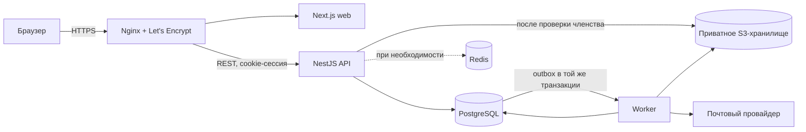

# Архитектура aymakh

Статус: проект архитектуры, этап 0. Это целевая архитектура; она ещё не реализована.

## Цели и ограничения

- Закрытая платформа без публичных деревьев, профилей и поиска по данным семей.
- Аккаунт может участвовать в нескольких деревьях; доступ выдаётся явно участником-владельцем.
- Все обращения к данным дерева проверяются сервером. Доступ к файлам выдаётся через короткоживущую ссылку после такой проверки.
- Модульный монолит, отдельные процессы `web`, `api`, `worker`; микросервисы не вводятся без измеримой причины.
- PostgreSQL — источник истины. Фоновые операции инициируются транзакционным outbox.
- Персональные данные умерших и живых родственников считаются чувствительными. Администратор платформы не получает штатный доступ к содержимому деревьев.

## Аудит исходного состояния

Текущий каталог содержит браузерный интерфейс `index.html`, Express API, PostgreSQL-схему и Docker Compose. В схеме — аккаунты `owner/editor`, одна строка `family_tree` и массив `members` в JSONB. API хранит одну общую версию дерева. Это исходный MVP, а не готовая целевая архитектура. Существующие данные и интерфейс не удалять; перед переносом данных нужен отдельный план миграции и резервная копия.

Стек уточнён владельцем 13 ноября 2026 года. Целевая конфигурация:

- Монорепозиторий TypeScript с pnpm workspace и зафиксированным `pnpm-lock.yaml`.
- Web: актуальная стабильная совместимая версия Next.js, React, TypeScript, Tailwind CSS и shadcn/ui.
- API: отдельное приложение NestJS с REST API и валидацией Zod. Централизованная авторизация находится в API. Вариант Next.js API не используется, чтобы сохранить отдельные процессы `web`, `api`, `worker`.
- Worker: отдельный NestJS-процесс для outbox, почты, миниатюр и поисковой индексации.
- Данные: PostgreSQL через Prisma ORM и версионированные миграции.
- Файлы: приватное S3-совместимое хранилище, MinIO на собственном сервере.
- Очереди: транзакционный PostgreSQL outbox — базовый механизм. Redis добавляется для кеша/очередей/временных данных, если нагрузка и эксплуатационные измерения оправдают его.
- Поиск: PostgreSQL FTS и `pg_trgm` в первой версии; Meilisearch или OpenSearch — только отдельным решением после измерений.
- Древо: React Flow — кандидат по умолчанию; на этапе интерфейса сравнить с профильной библиотекой на тестовом большом графе и выбрать по виртуализации, доступности и мобильному поведению.
- Инфраструктура: Docker, Docker Compose, Linux VPS, Nginx и Let's Encrypt, Git и CI/CD.
- Проверки: Vitest или Jest, Supertest, Playwright, ESLint и TypeScript checks.

Точные версии пакетов фиксируются на этапе 1 после проверки актуальных стабильных релизов и взаимной совместимости. Версии контейнеров также фиксируются; lock-файл коммитится. Выбор Redis и библиотеки графа остаётся условным и должен быть основан на измерениях, а не добавлен автоматически.

## Процессы и границы модулей

Логические модули API: аккаунты и сессии; деревья и членство; люди и отношения; события и источники; архив; поиск; приглашения и уведомления; импорт/экспорт; аудит. Модули используют прикладные сервисы и репозитории, не читают таблицы чужого модуля в обход его правил доступа.

## Изоляция деревьев

Каждая семейная сущность принадлежит одному `tree_id`. Для любой операции над такой сущностью API в одной транзакции устанавливает контекст пользователя, проверяет активное членство и роль, затем читает или меняет запись с ограничением по `tree_id`. Идентификатор из URL или тела запроса сам по себе прав не даёт. Ответы поиска, WebSocket-подписки, экспорт и получение файлов используют тот же путь проверки.

PostgreSQL RLS включается для таблиц с данными дерева как дополнительный уровень. Контекст пользователя задаётся транзакционным `SET LOCAL` на том же соединении, что и запрос. При использовании Prisma все запросы, которые зависят от контекста RLS, выполняются внутри interactive transaction; `SET LOCAL` задаётся через параметризованный raw-запрос на том же транзакционном клиенте. Пул соединений не должен переносить контекст между запросами. Миграции и фоновые процессы работают с отдельными ограниченными ролями; обход RLS привилегированной ролью не используется для пользовательских запросов. Проверки API остаются обязательными даже при RLS.

Ключи объектов в хранилище непрозрачны и не содержат публичных ссылок. Выдача файла: авторизованный запрос → проверка членства/права на объект → короткоживущая подписанная ссылка или потоковая передача. Удалённый/корзинный объект недоступен обычному чтению.

## Согласованность данных и фоновые задачи

Изменения дерева, запись истории и события outbox фиксируются одной транзакцией. Worker обрабатывает события идемпотентно, повторяет временные ошибки и сохраняет состояние попыток. Поисковая проекция строится только из уже проверенных записей дерева; в индекс не попадает материал без `tree_id`. Для редактирования используются версии записей и optimistic locking. Операции над родительскими связями сериализуются на уровне дерева или используют эквивалентную защиту от гонок, а затем проверяют отсутствие циклов.

## Совместимость и переход

До появления новых модулей MVP остаётся исходной точкой. Миграции БД должны быть версионированными, повторяемыми где возможно и проверяемыми на копии данных. Переход JSON-массива в нормализованные сущности — отдельная миграция с dry-run, отчётом о неразобранных записях, проверкой числа записей и планом отката. Не удалять старую структуру до подтверждённой сверки и проверенного восстановления.

## Диаграмма связей

См. `DATABASE.md`: там приведены сущности, связи, ограничения и ER-диаграмма Mermaid.
