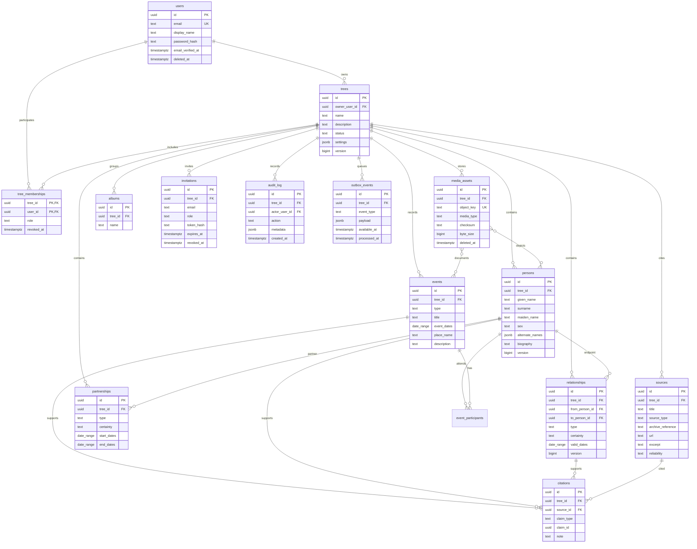

# Модель данных aymakh

Статус: проект модели, этап 0. Физические таблицы ещё не создавались.

## ER-диаграмма

## Правила проектирования

- Все записи, принадлежащие дереву, имеют обязательный `tree_id`; внешние ключи между ними составные (`tree_id`, `id`), чтобы нельзя было связать записи разных деревьев.
- Уникальные ограничения и индексы для таких записей включают `tree_id`. Внешние ссылки не принимаются без проверки принадлежности тому же дереву.
- `tree_memberships` хранит одну текущую роль участника: `owner`, `manager`, `editor`, `contributor`, `viewer`. Владелец дерева должен быть согласован с активным членством владельца; передача владения — отдельная атомарная операция.
- Даты представлены структурой `date_range`: нижняя и верхняя границы, точность (день/месяц/год/диапазон/примерно/историческое/неизвестно), исходная строка. Нельзя превращать неизвестную дату в выдуманное значение.
- `relationships` — направленные типизированные отношения между людьми, включая биологических/приёмных родителей и опекунов. Не ограничивать число родителей. `partnerships` хранит пары и интервалы; несколько браков разрешены. Дети выводятся из отношений, а не из дублирующего списка.
- Самоссылки запрещены. Для родительских типов запрещаются циклы; проверка выполняется в серверном доменном сервисе и защищается от параллельных изменений. Предположительные отношения сохраняют `certainty` отдельно от типа.
- События, участники событий, источники и цитаты являются отдельными сущностями. Связи цитат с фактами должны иметь целостность; окончательная схема может использовать отдельные таблицы связей по типам утверждений вместо полиморфного `claim_id`.
- Фото и документы имеют метаданные в PostgreSQL, содержимое — только в приватном S3-хранилище. Удаление сначала помечает объект для корзины; физическая очистка — отдельная политика после окна восстановления.
- История изменений и outbox append-only по возможности. Для аккаунтов, приглашений и сессий секреты хранятся только в виде стойких хэшей/безопасных секретов.

## Индексы и поиск

Планируются составные индексы с `tree_id` для отношений, событий, участников, медиа и источников; уникальность email; GIN для полнотекстовой проекции и `pg_trgm` для частичного/нечёткого поиска. Поисковая проекция строится worker-ом из outbox; каждый запрос ограничивается разрешёнными деревьями и повторно фильтруется авторизацией.

## RLS

RLS включается после появления транзакционного репозитория и тестов на реальном PostgreSQL. Политики проверяют `tree_id` через активное членство и роль. Контекст пользователя выставляется через `SET LOCAL` внутри транзакции. Нельзя полагаться на RLS, если подключение может работать с привилегированной ролью или контекст задан вне транзакции. Миграционный и операционный доступ отделяется от роли API.

## Миграция от MVP

Текущая таблица `family_tree(id=1, members jsonb)` не переносится автоматически при создании целевых таблиц. Сначала нужен форматный анализ существующего JSON, резервная копия, dry-run, отчёт по каждому человеку и связям, затем отдельное подтверждение и сверка. Оригинал сохраняется до успешного тестового восстановления и проверки результата.
